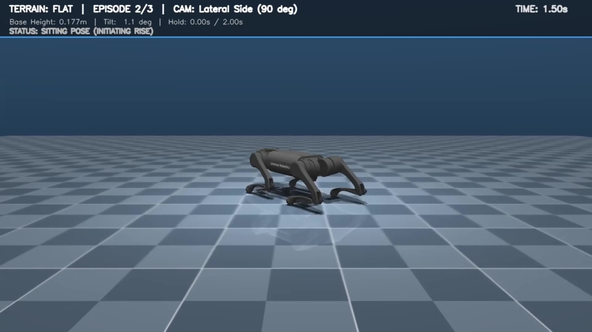
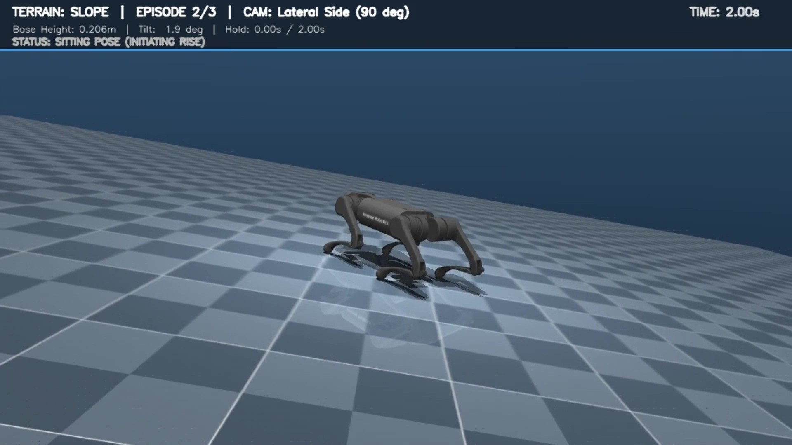
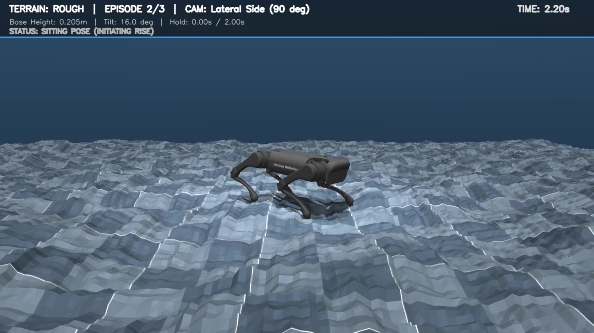
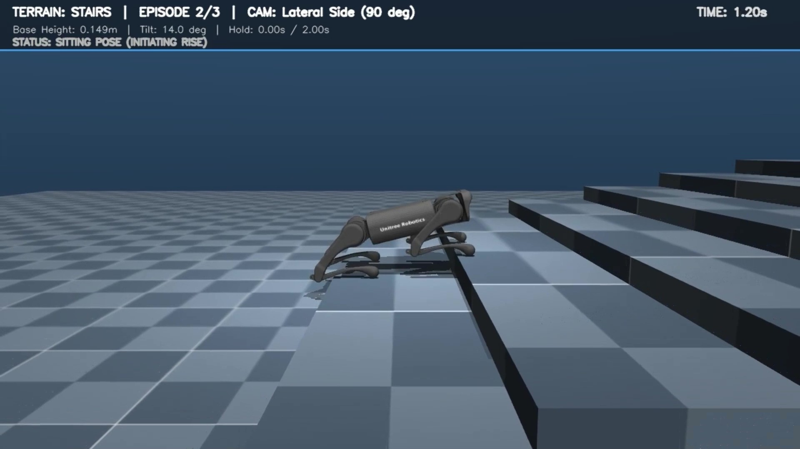
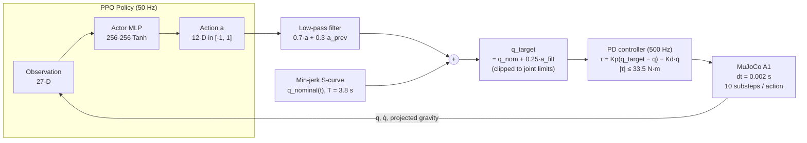
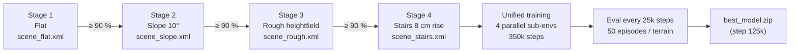
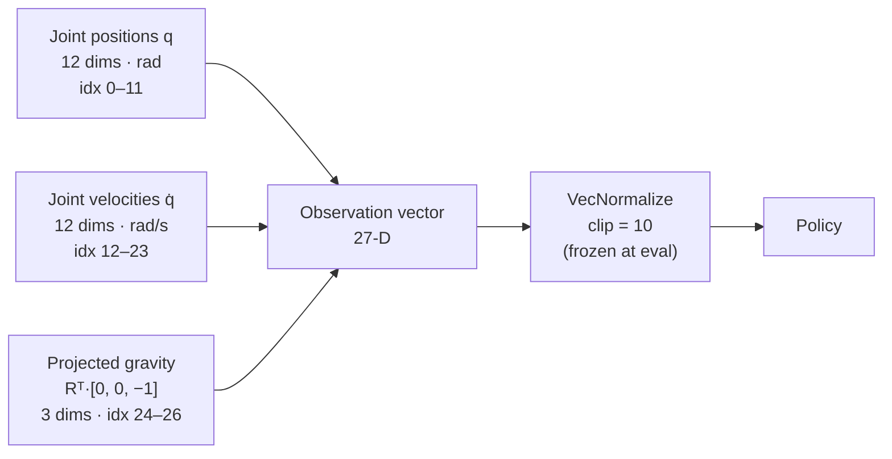
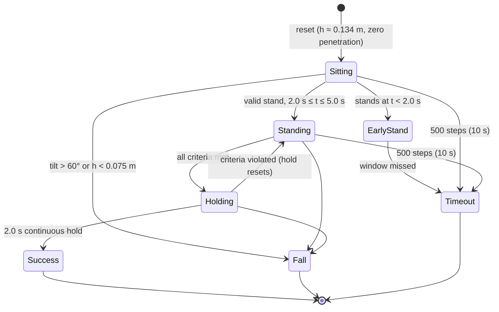
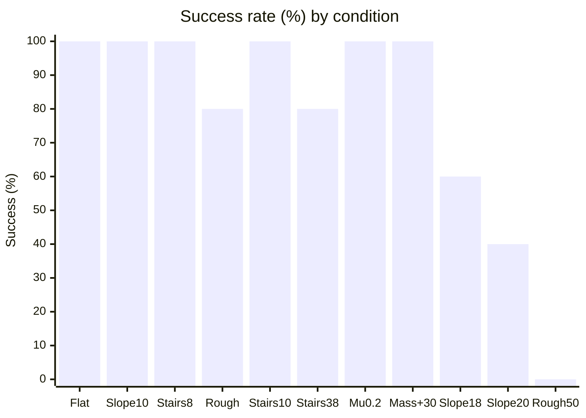
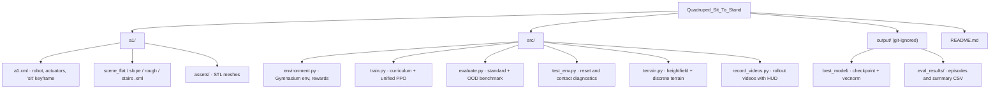

<h1 align="center">Unitree A1 Quadruped Sit-to-Stand RL</h1>

<p align="center">
  <em>Reinforcement-learning pipeline that trains a blind Unitree A1 quadruped to rise from a ground-sitting pose to a stable stand,
  using PPO as the high-level policy and an explicit joint-level PD controller for low-level torque control,
  evaluated across flat, sloped, rough and stair terrains.</em>
</p>

<table align="center">
  <tr>
    <td align="center" width="50%">
      <b>Flat Terrain</b><br><br>
      
    </td>
    <td align="center" width="50%">
      <b>Slope (10&deg;)</b><br><br>
      
    </td>
  </tr>
  <tr>
    <td align="center" width="50%">
      <b>Rough Terrain</b><br><br>
      
    </td>
    <td align="center" width="50%">
      <b>Stairs (8 cm)</b><br><br>
      
    </td>
  </tr>
</table>

<p align="center">
  
  
  
  
</p>

---


Reinforcement learning framework that trains a **blind** Unitree A1 quadruped to rise from a ground-sitting pose (torso on or just above the ground) to a stable upright stance across multiple terrains, using **PPO** in **MuJoCo 3.x**.

| | |
|---|---|
| **Robot** | Unitree A1 (12 DOF, 12 kg) |
| **Algorithm** | PPO, actor-critic MLP (2 × 256, Tanh) |
| **Observation** | 27-D blind proprioception |
| **Action** | 12-D residual joint targets + low-level PD |
| **Control rates** | Physics 500 Hz, policy 50 Hz |
| **Best checkpoint** | `output/best_model/best_model.zip` (unified training, step 125k) |

---

## System Overview



---

## Terrains and Training

Training has two phases.

1. **Staged curriculum.** Each stage advances only after **≥ 90 % success** over rolling evaluation episodes.
2. **Unified multi-terrain training.** A single policy is trained on four balanced parallel sub-environments (Flat, Slope, Rough, Stairs) for 350k steps. Checkpoints are evaluated every 25k steps, and the best one is kept.



| Stage | Scene | Description |
|---|---|---|
| 1 | `a1/scene_flat.xml` | Horizontal ground plane |
| 2 | `a1/scene_slope.xml` | Rigid 10° incline |
| 3 | `a1/scene_rough.xml` | Multi-scale procedural heightfield (401 × 401) |
| 4 | `a1/scene_stairs.xml` | Rigid stairs, **0.45 m tread, 0.08 m rise** |

---

## Observation Space (27-D, strictly blind)



> The policy receives **no** contact sensors, cameras, heightmaps, terrain normals, or action history.

---

## Action Space

- 12-D vector in `[-1, 1]`, interpreted as **residual** joint offsets on top of a nominal sit-to-stand trajectory.
- Residual scale: **±0.25 rad** (≈ ±14.3°).
- Filtering: `a_filt = 0.70·a_t + 0.30·a_filt,t−1`.
- Target: `q_target = clip(q_nominal(t) + 0.25·a_filt, q_lo, q_hi)`.
- Nominal trajectory: `α(t) = ½(1 − cos(π·clip(t / 3.8, 0, 1)))`, interpolating from `q_sit` to `q_stand`.

| Joint group | Kp (N·m/rad) | Kd (N·m·s/rad) | Torque limit |
|---|---|---|---|
| Abduction | 40 | 1 | ±33.5 N·m |
| Hip | 80 | 2 | ±33.5 N·m |
| Knee | 80 | 2 | ±33.5 N·m |

---

## Reward Design

| Term | Formula / gate | Weight |
|---|---|---|
| Height tracking | `exp(−40·(h_rel − h_nom)²)` | +2.0 |
| Terrain alignment | `exp(−5·(1 − cosθ_normal))` | +1.0 |
| Pose tracking | `exp(−0.4·‖q − q_nom‖²)` | +1.0 |
| **Early-stand penalty** | standing and `t < 2.0 s` | −4.0 |
| Standing bonus | standing and `t ≥ 2.0 s` | +1.5 |
| Stable bonus | stability criteria held ≥ 100 steps | +1.5 |
| Action smoothness | `‖a_t − a_t−1‖²` | −0.05 |
| Action magnitude | `‖a_t‖²` | −0.01 |
| Joint velocity | `‖q̇‖²` | −0.005 |
| Joint acceleration | `clip(mean(q̈²), 0, 1e4)` | −1e−5 |
| Base linear velocity | `‖v‖²` | −0.05 |
| Base angular velocity | `‖ω‖²` | −0.05 |
| Fall (terminal) | tilt > 60° or `h < 0.075 m` | −10.0 |

---

## Success Criteria

An episode **succeeds** when all of the following hold:

| Criterion | Threshold |
|---|---|
| Rise window | First valid stand at `2.0 s ≤ t ≤ 5.0 s` |
| Standing height | `h_rel ≥ 0.21 m` (relative to local terrain) |
| Torso alignment | Tilt ≤ 25° from terrain normal |
| Linear speed | `‖v‖ ≤ 0.25 m/s` |
| Angular speed | `‖ω‖ ≤ 0.60 rad/s` |
| **Stability hold** | All of the above continuously for **2.0 s** (100 control steps at 50 Hz) |



---

## Domain Randomization

Applied during training. Held-out evaluation conditions lie **outside** these ranges.

| Parameter | Nominal | Training range | Held-out (OOD) test |
|---|---|---|---|
| Ground friction μ | 0.80 | U[0.40, 1.20] | 0.20 |
| Trunk mass | 4.713 kg | ±15 % | 6.12 kg (+30 %) |
| Leg link masses | per link | ±10 % | nominal |
| Principal inertia | CAD | ±10 % | nominal |
| Torque noise | 0 | N(0, 0.5 N·m) | none |
| Action latency | 0 | 1 step (20 ms) | none |
| Slope pitch | 0° | 10° discrete, up to 15.5° procedural | 18°, 20° |
| Rough amplitude | 0 | 0.010–0.035 m | 0.050 m |
| Stair rise | 0.08 m | 0.04–0.08 m | 0.10 m |
| Stair tread | 0.45 m | 0.45 m | 0.38 m |

---

## Results

Evaluation setup: 5 episodes per condition, seed 42, deterministic inference, frozen normalization statistics. **Zero falls across all runs.**

### Standard terrains

| Terrain | Success | Rise time (s) | Stabilize time (s) |
|---|---|---|---|
| Flat | 5/5 (100 %) | 2.160 ± 0.000 | 2.160 ± 0.000 |
| Slope 10° | 5/5 (100 %) | 2.120 ± 0.028 | 2.120 ± 0.028 |
| Stairs 8 cm | 5/5 (100 %) | 2.592 ± 0.010 | 2.592 ± 0.010 |
| Rough | 4/5 (80 %) | 2.652 ± 0.404 | 2.550 ± 0.389 |

### Held-out robustness (OOD)

| Condition | Success | Rise time (s) |
|---|---|---|
| Tall stairs (10 cm) | 5/5 (100 %) | 2.812 ± 0.059 |
| Narrow stairs (38 cm tread) | 4/5 (80 %) | 2.312 ± 0.016 |
| Low friction (μ = 0.20) | 5/5 (100 %) | 2.124 ± 0.008 |
| Payload (+30 % mass) | 5/5 (100 %) | 2.168 ± 0.020 |
| Slope 18° | 3/5 (60 %) | 2.100 ± 0.075 |
| Slope 20° | 2/5 (40 %) | 2.050 ± 0.050 |
| Severe rough (50 mm) | 0/5 (0 %) | 2.810 ± 0.581 |



---

## Known Limitations

- **Steep slopes (18°, 20°):** failed episodes did not fall. The robot reached a valid stance at about 1.92–1.98 s, just before the 2.0 s lower rise bound, so the episode timed out.
- **Severe roughness (50 mm):** the policy rises, but uneven footing keeps base velocities above the stability thresholds, so the stable hold lasts only about 0.39 s.
- **Small sample size:** 5 episodes per condition is a coarse estimate. Run `--episodes 50` or more for meaningful confidence intervals.
- **Blind controller:** there is no exteroception, so terrain adaptation is purely reactive.
- **Simulation only:** not validated on physical hardware. Motor thermal limits, communication jitter, and IMU drift are untested.
- **Training logs:** raw TensorBoard logs were not retained. Convergence was audited via saved checkpoints.

---

## Project Structure



---

## Quickstart

### 1. Verification and diagnostics

Validate terrain loading, contact points, and the initial sitting pose without rendering:
```bash
python src/test_env.py --terrain all --check-only
```

Launch an interactive viewer on stairs:
```bash
python src/test_env.py --terrain stairs --interactive
```

Verify curriculum stages and configuration:
```bash
python src/train.py --check-only
```

### 2. Training

Start staged curriculum training:
```bash
python src/train.py --n-envs 4 --run-name ppo_a1_curriculum
```

Resume from a specific stage or checkpoint:
```bash
python src/train.py --start-stage 1 \
  --checkpoint-model output/models/ppo_a1_curriculum/stage_1_flat_final.zip \
  --checkpoint-vecnorm output/models/ppo_a1_curriculum/stage_1_flat_vecnorm.pkl
```

### 3. Evaluation

Evaluate the best unified checkpoint across the benchmark terrains:
```bash
python src/evaluate.py --model output/best_model/best_model \
  --vecnorm output/best_model/best_model_vecnorm.pkl \
  --terrain benchmark --episodes 50
```

Results are written to `output/eval_results/evaluation_episodes.csv` and `evaluation_summary.csv`.

### 4. Video recording

Record demonstrations with HUD telemetry:
```bash
python src/record_videos.py --model output/best_model/best_model \
  --vecnorm output/best_model/best_model_vecnorm.pkl \
  --terrain all --episodes 1
```
